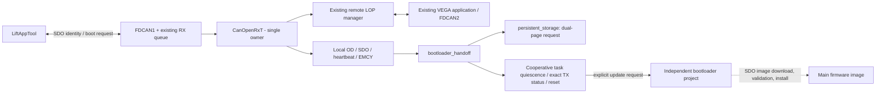
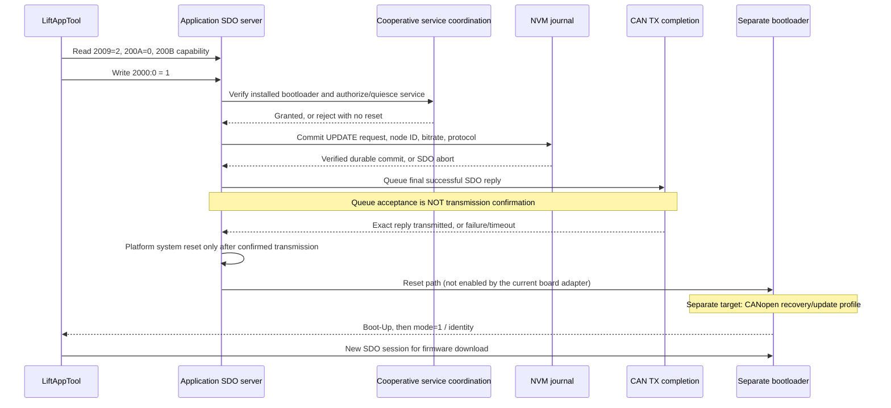
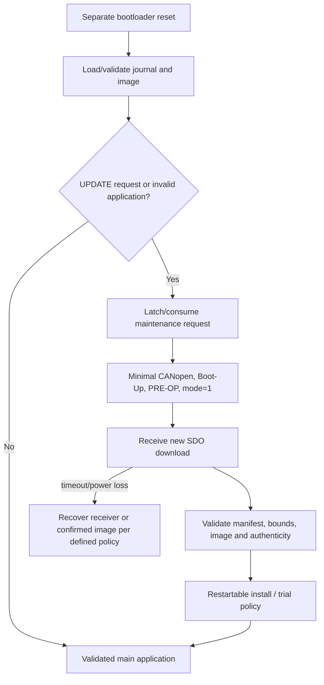

# CANopen LOP gateway and separate CANopen bootloader integration

## Decision and current release boundary

**The bootloader, not the application, will receive and install firmware.**
The existing application continues translating CANopen LOP <-> VEGA. It exposes
identification/diagnostic OD and a small request-to-bootloader interface.
The standalone bootloader project is `C:\Projects\CANOPEN_Bootloader_STM32G0`;
it is not linked into this application.

Implemented here:

- Removal of the application image receiver, image CRC/size/manifest writes and
  the old `firmware_update` / `bootloader_interface` modules.
- A portable application handoff state machine: service authorization -> durable
  request -> final SDO response -> exact TX confirmation -> platform system reset.
- Explicit recovery when transmission, NVM or a reset callback fails.
- NVM schema 2 with backward-compatible schema 1 reads.
- An application-mode / protocol-version / capability discovery interface.
- Tests with injected storage, transport confirmation and reset callbacks.

The application linker now targets Slot A at `0x08009000`, reserves the final
2 KiB slot page for its manifest, and relocates VTOR to the Slot-A vector table.
It also confirms a trial image after the scheduler, both FDCAN peripherals, and
all four critical tasks pass a 1-second stability check; failure to reach that
state within 5 seconds resets without confirmation.

**The STM32 handoff backend is now connected.** It checks the installed
bootloader vector and discovery record at `0x08008FE0`, cooperatively quiesces
the other three translation tasks, persists the request, checks successful
transmission of the exact FDCAN TX buffer carrying the final reply, and resets.
Normal startup boots a valid signed application. An explicit SDO update
request enters service mode; application 0.1.1 also implements the bounded,
addressed NMT discovery policy below (apart from invalid-image/transaction recovery).
There is deliberately no physical service interlock in this prototype.
A prototype Ed25519 key pair now exists in the standalone bootloader project;
its private half is DPAPI-protected in the developer's local profile and is
not in source control. Signature verification is enabled. Initial sparse HEX
generation, selective SWD commissioning/recovery and the independent PC CAN
update client are documented in the bootloader project's `Tools/README.md`.
This prototype key is not a production signing identity.

This implementation is not a full CiA 301/302/417 conformance or MISRA claim.
All `0x2000..` objects below are vendor specific. The first LiftAppTool transfer, activation and application launch were confirmed
on hardware with bootloader 1.0.5. Repeated entry through the new NMT discovery
policy is native-tested/ARM-built but still requires hardware verification.

### Application 0.1.1: addressed NMT Reset Node discovery

Only `0x000`, DLC 2, `81 01` (local Node 1) requests a five-second bootloader
window. Broadcast resets, other nodes and Reset Communication retain their
previous behavior. The local dispatcher requires no pending TX/SDO transfer,
valid factory identity, IDLE/CONFIRMED journal, successful existing service
quiescence and an installed bootloader advertising capability bit 1.
Trial images cannot request this transition. The existing journal records
`boot_request=2`, Node 126, 250 kbit/s, protocol 2; no SDO reply is fabricated.
Reset happens only after successful persistence. Save/reset failures use the
same reconciliation and service-interlock retention as vendor handoff.

Bootloader 1.0.6 consumes this request once, waits 5000 ms for a successful
local SDO exchange, then returns to a valid idle application if none arrives.
A successful exchange retains service mode for the update. An ordinary power-on
has no delay. This is an explicit vendor policy, not general CiA NMT semantics.
There is no physical safety authorization: use a controlled bench.

The final word of the boot contract is now flags: signing bit 0, bounded NMT
discovery bit 1. This application accepts the old value 1 for vendor SDO entry,
but NMT discovery requires bit 1 (current flags 3). The old 0.1.0 application
compares all eight words exactly and cannot hand off to the new contract.
**Upgrade the application first through old bootloader 1.0.5 using manual
`0x2000:00=1` entry; then selectively program bootloader 1.0.6 by SWD.**
Preserve factory and journal. See the bootloader README for exact frames and
the generated signed `out/vega-0.1.1.update.bin` container. Both components are
needed for automatic repeated LiftAppTool entry.

## Work plan

### Application dead-code cleanup

The old standalone master-heartbeat sender has been removed. `CanOpenRxT`
owns boot-up and periodic heartbeat through `CanopenPort_Poll` / `Co_Poll`;
the producer interval comes from OD `0x1017`, not a separate task constant.
The unused software-timer subsystem, legacy virtual-I/O Flash API and duplicate
FDCAN utility header have also been removed. The bounded `Flash_Nvm*` adapter
and shared protocol utilities remain in use. HAL callbacks, interrupt handlers,
FreeRTOS hooks and generated peripheral/runtime support are retained.

Regenerate the CubeIDE build files after removing sources; an existing build
directory may still contain old source/object/dependency lists.

| Step | Work | Status |
|---|---|---|
| 1 | Keep existing LOP/VEGA translation, master NMT and remote monitoring | Preserved |
| 2 | Remove firmware streaming/installation from application OD and build | Implemented |
| 3 | Add versioned handoff contract and durable NVM request | Implemented |
| 4 | Gate reset on exact successful SDO response transmission | Portable tests + STM32 TX buffer status backend; hardware validation required |
| 5 | Verify migration, interrupted writes, ACK ordering, failures and ARM build | Automated validation |
| 6 | Choose image/recovery storage, linker addresses, signatures and service entry | STM32G0B1RCT6: 36 KiB bootloader, 104 KiB payload per slot, signed manifest; explicit command, no physical interlock |
| 7 | Build minimal independent CANopen bootloader; integrate real STM32 callbacks | Standalone target implemented; target/hardware qualification remains |
| 8 | Power-cut, watchdog, bus-off, LiftAppTool and LOP regression bench testing | Hardware qualification remains |

## Architecture and ownership



Dependencies are acyclic:
`canopen_port -> canopen -> canopen_sdo/object_dictionary -> bootloader_handoff
-> persistent_storage -> canopen_types`.
EMCY also uses the OD; heartbeat/NMT wire helpers only use portable frame types.
No module receives an image in this application anymore.

All local OD/SDO/handoff/NVM operations run in `CanOpenRxT`, not an ISR.
The STM32 adapter now supplies the boot platform callbacks. Normal translation
continues until an explicit service request. The three other translation tasks
acknowledge quiescence at outer-loop boundaries without holding their mutexes.
Entry fails if all three do not acknowledge within 1000 ms.
Entry is also refused while the running image is an unconfirmed trial.
This is operator-authorized bench downtime, not a physical safety condition.
No code here assumes that an NMT Stop or a software flag makes a lift safe.

CANopen queues, mutex and remote-node pool are statically allocated. This does
not imply that the entire legacy RTOS application is heap-free or race-free.
The legacy LOP configuration SDO client is unchanged; it is not a general-purpose
segmented/block client.

## Application OD

Wire numbers are little-endian. Strings omit their trailing NUL. No PDO mapping
is enabled for local OD entries.

| Index | Sub | Name | Type | SDO access | Source |
|---|---:|---|---|---|---|
| 1000 | 0 | Device type; default 0, no profile asserted | U32 | RO | CiA 301 |
| 1001 | 0 | Error register | U8 | RO | CiA 301 |
| 1003 | 0 | Error count; write 0 clears history, not error register | U8 | RW | CiA 301 |
| 1003 | 1..8 | Populated newest-first error history | U32 | RO | CiA 301 |
| 1008 | 0 | Module name | VISIBLE_STRING, max 31 | RO | CiA 301 |
| 1009 | 0 | Hardware version | VISIBLE_STRING, max 31 | RO | CiA 301 |
| 100A | 0 | Application software version | VISIBLE_STRING, max 31 | RO | CiA 301 |
| 1014 | 0 | EMCY COB-ID, 0x81 for Node 1 | U32 | RO | CiA 301 |
| 1017 | 0 | Heartbeat period in ms; 0 disables | U16 | RW/persistent | CiA 301 |
| 1018 | 0 | Highest identity subindex = 4 | U8 | RO | CiA 301 |
| 1018 | 1 | Vendor ID | U32 | RO | CiA 301 |
| 1018 | 2 | Product code | U32 | RO | CiA 301 |
| 1018 | 3 | Revision number | U32 | RO | CiA 301 |
| 1018 | 4 | Serial number | U32 | RO | CiA 301 |
| 1200 | 0 | Highest SDO-server parameter subindex = 2 | U8 | RO | CiA 301 |
| 1200 | 1 | Client -> server COB-ID, 0x601 | U32 | RO | CiA 301 |
| 1200 | 2 | Server -> client COB-ID, 0x581 | U32 | RO | CiA 301 |
| 2000 | 0 | 1 = request bootloader; 0 = recover a FAILED handoff | U8 | WO | Vendor, protocol 2 |
| 2001 | 0 | Application handoff state | U8 | RO | Vendor, protocol 2 |
| 2006 | 0 | Running application's numeric version from firmware | U32 | RO | Vendor |
| 2007 | 0 | Application handoff result | U8 | RO | Vendor, protocol 2 |
| 2009 | 0 | Handoff protocol version = 2 | U32 | RO | Vendor |
| 200A | 0 | Execution mode: 0 = application; bootloader reports 1 | U8 | RO | Vendor |
| 200B | 0 | Entry capability: 1 only if all backend checks/hooks are present | U8 | RO | Vendor |

**Removed from application:** `0x2002` firmware data, `0x2003` expected CRC,
`0x2004` size, `0x2005` pending version and `0x2008` manifest. Reads and downloads
abort with `0x06020000`. The application does not accept image bytes.
Old finish/cancel commands 2/3 at `0x2000` now abort with `0x06090030`.

This is an intentional incompatible revision of the earlier, never-enabled
vendor update protocol. LiftAppTool must check `0x2009` and `0x200A` before using
`0x2000`; it must not assume the old command 1 still starts an image stream.
An existing tool unaware of protocol 2 must not be used for the future enabled
entry path. None of these commands implies CiA 302 program-download compliance.

State values: `0 IDLE, 1 WAIT_ACK, 2 RESETTING, 4 FAILED, 6 UNAVAILABLE`.
Result values: `0 NONE, 1 OK, 2 UNSUPPORTED, 3 SERVICE_DENIED, 4 STORAGE,
5 TX_TIMEOUT, 6 TX_FAILED, 7 RESET_RETURNED, 8 RECOVERY_REQUIRED`.
Currently capability is 0, state is 6 and result is 2 unless an unconsumed
persisted boot request is discovered (then FAILED / RECOVERY_REQUIRED).

`0x1008` comes from `APP_MODULE_NAME` in `firmware_identity.h`. `0x100A`
and `0x2006` come from the same version components in that header: currently
**0.1.0**, numeric **0x00000100** (major[31:16], minor[15:8], patch[7:0]).
Rebuild with new components for a release; no boot-time Flash write is needed.
Rollback automatically reports the version of the application actually running.

`0x1009` and `0x1018:1..4` come exclusively from the validated factory page
described below, never from legacy journal identity fields. Hardware text uses
numeric `major.minor` (for example `1.3`). Product Revision Number in `0x1018:3`
is separately assigned by the manufacturer, not implicitly a PCB/SW version.
If factory data is missing/corrupt: HW is `"unconfigured"`, numeric identity is
zero, an EMCY 0x5000 is queued (detail `0x46490000 | FiResult`), and boot-entry
command 1 returns hardware abort 0x06060000. No invented hardware default or
automatic migration from untrusted old NVM is performed. Existing LOP traffic
is not disabled by this identification diagnostic.

All identity/version objects reject both expedited and segmented SDO writes.
There is no RPDO mapping to these objects. Future mapping support must retain
that prohibition. This is protocol-level immutability, not protection against
debug access, malicious firmware or a full-chip erase.

## Entry protocol: application side implemented



`bootloader_handoff.c` requires a valid committed NVM record before entry.
Blank/corrupt/unreadable NVM is not silently converted into a boot decision.
Duplicate requests while transitioning are rejected; other OD writes are blocked
until the transition completes or a failed request is durably cleared.
The owner stops dequeuing frames during WAIT_ACK. It does not reset inside
`Od_Write` or inside a CAN callback.

The default confirmation deadline is 2000 ms from the request's supplied
timestamp. Only the successful final response is eligible: the expedited
download ACK, or the final segment ACK for a segmented command. Initial segmented
download ACK does not start a handoff. The caller must poll regularly and its
platform callbacks must be bounded; time uses unsigned millisecond subtraction.

On timeout/TX failure, any queued response must be retired through `cancelAck`,
then the committed request is cleared before leaving service. If a response has
not even been queued, it is replaced by an SDO abort rather than sent later as
a stale success. If NVM clearance or TX retirement cannot be proved, the state
stays FAILED/RECOVERY_REQUIRED and the tasks are NOT resumed.
The tool can read diagnostics and write `2000=0` to retry cleanup.

An NVM operation can fail after its commit reached Flash. Cleanup therefore
reloads the journal instead of trusting the last RAM snapshot. A reset callback
which returns is also treated as a fault, not as successful entry.

**Power-loss window:** once UPDATE is committed, a power failure may enter the
separate bootloader even if the tool never received the SDO reply. This must be
safe: UPDATE means "enter maintenance receiver", NEVER "erase/install an image".
The tool must rediscover mode after any ambiguous timeout. CAN ACK proves bus
transmission, not that LiftAppTool's process consumed the reply.

If the application starts and still sees UPDATE, it reports RECOVERY_REQUIRED
and does NOT auto-reset; this prevents a boot loop when the bootloader has not
consumed the request.

## Board callbacks: STM32 backend connected

`BootHandoffPlatform` is a small contract, not a bootloader implementation:

| Callback / field | Requirement before enabling |
|---|---|
| `installed` | Verify actual installed/protected bootloader, agreed entry/layout and protocol, not just a compile-time bool |
| `bitrate` | Exact CANopen bus bitrate inherited by bootloader; bootloader Node-ID 126 is stored |
| `enterService` | Explicit request authorizes downtime; cooperatively quiesce other tasks |
| `leaveService` | Resume only after failed request is safely cleared |
| `ackStatus` | Confirm THIS final SDO reply; bus-off/abort must not count as success |
| `cancelAck` | Idempotently retire/abort this reply on failure; report inability to prove retirement |
| `reset` | Execute system reset; never return, never jump directly to a guessed address |

The FDCAN adapter records `HAL_FDCAN_GetLatestTxFifoQRequestBuffer` immediately
after queuing the final response. Other producers are already quiescent.
`TXBTO` must confirm that exact buffer; `TXBCF` detects cancellation.
Failure cancellation aborts that buffer and waits at most 50 ms for retirement.
Neither
`HAL_FDCAN_AddMessageToTxFifoQ == HAL_OK`, an empty TX FIFO, a delay nor a cleared
pending bit alone proves successful transmission of this exact response.
Do not use the ordinary `CoSend` queue-acceptance result as that proof.

The reset callback calls `NVIC_SystemReset`; no direct jump from RTOS context
is used. A physical lift service interlock is deliberately absent per prototype
scope. CAN access is trusted; the service command is not authenticated. Validate
TX correlation, bus-off/cancellation and all task quiescence on a controlled bench.

## Flash / persistent handoff ABI

Current shared map for STM32G0B1RCT6: 256 KiB Flash, 144 KiB RAM.
Both configurations select `STM32G0B1RCTx` and `STM32G0B1RCTX_FLASH.ld`.
Old VETX/512 KiB maps are obsolete and must not be used on this board.

| Addresses | Size | Role |
|---|---:|---|
| 08000000..08008FFF | 36 KiB | Independent signed bootloader |
| 08009000..080237FF | 106 KiB | Slot A, final 2 KiB page is manifest |
| 08023800..0803DFFF | 106 KiB | Slot B, final 2 KiB page is manifest |
| 0803E000..0803E7FF | 2 KiB | Restartable swap scratch |
| 0803E800..0803EFFF | 2 KiB | Factory identity, excluded from firmware images |
| 0803F000..0803F7FF | 2 KiB | Journal page 0 |
| 0803F800..0803FFFF | 2 KiB | Journal page 1 |
| 20000000..20023FFF | 144 KiB | RAM |

The Flash adapter bounds access to the two reserved pages and checks actual
capacity/bank geometry. Bank-swapped dual-bank configuration is refused rather
than guessed. No runtime API writes/erases the factory page. Both linker scripts
reserve it without emitting initialized data at that address; ordinary application
ELF/BIN output does not contain a factory record.
Full-chip erase by a programmer still destroys identity and requests. Programmer
settings must use selective sector/page erase; linker reservations cannot prevent
mass erase. Hardware WRP option-byte protection is a production decision requiring
board validation (factory is page 125 in single-bank mode, bank 2 page 61 in
normal 256-KiB dual-bank mode).
No option bytes are changed by this implementation.

The identical `device_memory.h` in both repositories defines this contract.
The application payload limit is 104 KiB; its manifest starts at `0x08023000`.
The discovery record at `0x08008FE0` checks the new slot size and metadata
addresses before handoff. Journal swap states cover 53 pages / 159 phases.
The Flash adapter checks actual capacity, page geometry and unswapped banks
on reads AND writes. Erase page numbers come from the shared bank-aware planner.
Bootloader multi-page erases split at the actual bank boundary.
Existing packages/factory HEX must be regenerated; reprogram the bootloader
through SWD and commission a clean journal. The old factory address
`0x0807E800` does not exist on RCT6.

Each page contains one 256-byte serialized record:

| Byte offsets | Schema 2 content |
|---|---|
| 0 / 4 / 8 | Magic 0x434F5053 / schema 2 / wrapping sequence |
| 16 / 48 / 80 | Legacy name/HW/SW strings retained only for schema compatibility, NOT OD authority |
| 112 / 116 / 120 / 124 | Legacy vendor/product/revision/serial, NOT OD authority |
| 128..159 | Existing firmware metadata/slot fields retained for schema compatibility; application no longer changes them through image OD |
| 160..161 | Heartbeat ms, U16 |
| 164 | `boot_request`: 0 normal, 1 enter update receiver |
| 168 | CANopen node ID, U32, 1..127 when requested |
| 172 | Bitrate in bit/s, U32, nonzero when requested |
| 176 | Handoff protocol = 2 when requested |
| 180..239 | Reserved |
| 240..243 | CRC-32 over bytes 0..239 |
| 248..255 | Commit 0x434F4D54 and complement, written last |

CRC-32/ISO-HDLC: reflected polynomial EDB88320, initial/final XOR FFFFFFFF,
check `"123456789"` = CBF43926. No C-struct packing/ABI is used for persistence.
New writes use schema 2; schema 1 loads with a zero boot request regardless of
old reserved FF bytes. Migration is on the next successful save, not boot-time
erase. A schema-1-only bootloader is NOT compatible with schema 2.
Do not boot an older application which writes schema 1 after installing the
future schema-2 boot protocol; it could silently discard the new request fields.

`Ps_Save` writes only the inactive page, verifies data before commit and verifies
the committed record. `Ps_Load` selects the latest fully valid sequence. Copies
are configuration/request redundancy, NOT application A/B firmware slots.

### Factory identity ABI v1 and production provisioning

`factory_identity.h/.c` is shared portable code for the application, future
bootloader and host provisioning tool. It uses explicit little-endian bytes,
not C struct layout. CRC is CRC-32/ISO-HDLC, shared with `persistent_storage`.
The first 128 bytes of the dedicated 2-KiB page contain:

| Byte offsets | Content |
|---|---|
| 0 / 4 / 8 | U32 magic 0x46494431 / schema 1 / length 128 |
| 12 / 16 | U32 assigned Vendor ID / Product Code |
| 20 / 24 | U32 manufacturer Product Revision Number / Serial Number |
| 28 | U32 hardware variant (nonzero product-specific identifier) |
| 32 / 34 | U16 hardware major / minor |
| 36..119 | Reserved, must remain FF |
| 120 | U32 CRC over bytes 0..119 |
| 124 | U32 commit 0x46434D54 |

Vendor, product, variant and serial reject zero/FFFFFFFF; product revision rejects
FFFFFFFF; HW components reject FFFF. These are manufacturer validation rules,
not an allocation of a real CiA Vendor ID. Decoder rejects unknown schema,
wrong length, missing commit, CRC/reserved-byte corruption and invalid fields.
On error it clears the output. Blank/interrupted provisioning requires explicit
factory re-provisioning; the application never repairs it using guesses.

Host-only generator source: `Tools/factory_identity_tool.c`. Example compilation
with a native C compiler (not ARM GCC):

```powershell
gcc -std=c99 -Wall -Wextra -Werror -ICore\Inc Tools\factory_identity_tool.c Core\Src\factory_identity.c Core\Src\persistent_storage.c -o factory_identity_tool.exe
.\factory_identity_tool.exe <assignedVendorId> <productCode> <productRevision> <serial> <hardwareVariant> <hwMajor> <hwMinor> factory.bin
```

The generator validates fields and creates exactly 128 bytes. It does not flash
the MCU and does not allocate manufacturer identifiers. Program at **0x0803E800**
using SWD/ST-LINK in manufacturing, with an explicit erase of only the factory
page. Program bytes 0..119 first, then the final doubleword 120..127 (CRC+commit);
read back and run the same decoder before releasing the device. Do not overwrite
factory data during ordinary firmware updates. A controlled board replacement
or correction must be traceable through the manufacturing process. Safeguard
the record backup and uniqueness of serial numbers.
The separate configuration journal still needs commissioning (for example an
SDO write to `0x1017` initializes its heartbeat setting). Factory provisioning
does not initialize or overwrite the update journal. Handoff requires a valid
committed journal as well as valid factory identity.

Separate bootloader implementation and remaining qualification:

1. Reserve the identical factory/NVM addresses in its linker script; use the
   shared decoder and validate the record on every startup.
2. Keep recovery communication available on missing/corrupt identity, but refuse
   application erase/program/activation until hardware identity is established.
3. Validate the image header and its authenticity before trusting its vendor,
   product, hardware variant and inclusive HW revision limits. Use
   `Fi_Compatible`; unknown identity, different variant/product/vendor or an
   out-of-range revision must be rejected **before erase**. HW revision numeric
   encoding is major[31:16], minor[15:0]. CRC alone is not image authenticity.
4. Bound **every** image write and entire erase-page range with
   `Fi_ApplicationRange`, then further exclude the bootloader's protected
   area and enforce the final application load address. The helper currently
   allows 0x08000000..0x0803E7FF; it is not a complete bootloader memory policy.
   Backup/staging areas also must never overlap factory or journal pages.
5. Expose the same factory hardware/product/serial through bootloader OD, while
   exposing its own firmware name/version and execution mode 1. Never copy pending
   image version into application OD. Mark confirmed metadata only after self-test.

The independent bootloader target and image installer now exist in
`CANOPEN_Bootloader_STM32G0`. It uses a durable A/B page-swap/trial/rollback
transaction. The application does not contain that installer. This design and
implementation do not yet establish a production-qualified physical update
path or hardware tamper resistance: the installed prototype key is not an
approved production identity, generated factory files still need physical
programming, and the now-enabled STM32 handoff backend needs bench qualification.

## Independent bootloader and remaining qualification

The separate ELF target has no VEGA/LOP dependency or automatic remote-node
start role and uses a cooperative loop. It implements the CANopen recovery,
manifest, update, and restartable transaction paths. Hardware and
interoperability qualification remain required:

1. Verify the request journal; validate node/bitrate/protocol against supported
   bus settings. Latch/consume UPDATE safely, then expose mode 1.
2. If no UPDATE and the main image is valid, boot it. If invalid, stay in a
   documented recovery receiver; do not jump to invalid vectors.
3. Boot-Up, heartbeat, appropriate NMT state handling and SDO server. No LOP PDO,
   VEGA or remote network-management role.
4. Identity of the same physical module, installed application version and a
   separately identifiable bootloader version.
5. Firmware manifest/image reception, size/range/compatibility and authenticity
   validation, 8-byte Flash programming buffering, read-back verification.
6. No erasure merely because UPDATE was requested. Erase only after an explicit
   validated download operation and sufficient recovery storage are available.
7. Restartable activation and, if required, actual backup/rollback plus
   trial/watchdog/confirmation metadata. These need a separate versioned boot
   transaction design; `boot_request=1` is not an activation flag.



The protected range, vector relocation, image limit, A/B scratch strategy, and
linker/startup layout are defined in the standalone project. Slot B images are
linked for Slot A and page-swapped before execution; they are not executed in
place. The bootloader uses a versioned vendor SDO profile; LiftAppTool
compatibility and any CiA 302-3 interoperability remain to be validated.

## Vendor client frame sequence (not a captured LiftAppTool sequence)

Node 1: standard Classic CAN data frames, SDO request 601, reply 581, DLC 8.

| Direction | COB-ID | Payload hex | Meaning |
|---|---|---|---|
| Tool -> app | 601 | 40 09 20 00 00 00 00 00 | Read protocol |
| App -> tool | 581 | 43 09 20 00 02 00 00 00 | Protocol 2 |
| Tool -> app | 601 | 40 0A 20 00 00 00 00 00 | Read execution mode |
| App -> tool | 581 | 4F 0A 20 00 00 00 00 00 | Application mode |
| Tool -> app | 601 | 40 0B 20 00 00 00 00 00 | Entry capability |
| Current app -> tool | 581 | 4F 0B 20 00 00 00 00 00 | Entry unavailable: no validated bootloader |
| Tool -> app | 601 | 2F 00 20 00 01 00 00 00 | Request entry |
| App with valid factory record, no backend -> tool | 581 | 80 00 20 00 22 00 00 08 | State abort; NO reset |
| App without valid factory record -> tool | 581 | 80 00 20 00 00 00 06 06 | Hardware abort; NO reset |
| Future enabled app -> tool | 581 | 60 00 20 00 00 00 00 00 | Durable entry request accepted |
| Bootloader -> network | 77E | 00 (DLC 1) | Boot-Up at Node 126 after reset |
| Tool -> bootloader | 67E | 40 0A 20 00 00 00 00 00 | Confirm execution mode |
| Bootloader -> tool | 5FE | 4F 0A 20 00 01 00 00 00 | Required mode 1 |

The final four lines are an integration contract, not current hardware behavior.
Wait for mode 1 with a bounded timeout; a generic heartbeat or CAN ACK does not
identify a bootloader. End any pre-reset segmented SDO session. Start a NEW
session for firmware reception only after confirming the bootloader.
The bootloader now uses Node 126 for recovery and update, including older
handoff records. The application keeps its normal Node-ID. Manual page 16 and
the actual LiftAppTool trace confirm the reserved bootloader address; page 28
shows block download to `0x1F50:01`. The bootloader implements this data alias
and bounded block download, but still requires the signed manifest and vendor
begin/verify/activate commands. Password/control and file-format compatibility
with the wizard remain unverified. Do not interpret ordinary NMT reset as an
authorized firmware-update request.

Unchanged identity requests:
`40 08 10 00 00 00 00 00` name,
`40 09 10 00 00 00 00 00` HW,
`40 0A 10 00 00 00 00 00` application SW,
`40 18 10 04 00 00 00 00` serial.
Strings longer than 4 bytes use segmented upload with alternating 60/70 requests.

## Validation / deployment gates

`Tests/test_canopen.c` and `Tests/run.ps1` compile only current portable modules.
Use a native C compiler, not arm-none-eabi-gcc, to execute tests. If PowerShell
script execution is disabled, compile the listed C sources directly; do not
change machine policy. The VS Code test adapter does not discover this standalone
C executable.

Automated coverage:

- Factory ABI round trip, 1024 single-bit corruptions, every truncated/interrupted
  record, unsupported schema/reserved bytes, missing identity and field limits.
- Hardware compatibility rejection and inclusive revision boundaries; application
  range bounds exclude factory/NVM and reject overflow/empty ranges.
- Firmware/factory OD ignores stale journal identity; expedited/segmented writes
  rejected; unprovisioned handoff refused even with an available mock backend.
- Schema 1 -> 2 identity retention and no false request from reserved bytes.
- 256 interrupted request-write positions, CRC/commit fallback and invalid input.
- Unavailable backend, denied service, NVM errors including error AFTER commit.
- No reset before durable request AND final response queueing AND exact TX proof.
- Returning reset callback treated as failure.
- TX failure/deadline across timer wrap; durable clear before service release.
- Failed TX retirement / failed clear retains task quiescence; explicit recovery.
- Unconsumed request on application startup does not cause reset loops.
- Expedited and segmented entry commands; no side effect on initiate-only ACK.
- Identity/heartbeat/EMCY regression and exact device-name CAN payloads.
- Removed image objects rejected for upload/download.
- 65536 deterministic malformed SDO requests.
- Full ARM compile/link and strict warnings on portable modules.

Hardware validation remains mandatory: installed bootloader verification,
authorization/service interlock, exact TX-event correlation under concurrent
traffic, bus-off/cancel/event FIFO loss, power cut during request and image writes,
real LiftAppTool session rediscovery, application recovery and LOP/VEGA traces.
The existing linker RWX warning remains. Host tests do not certify real-time
Flash behavior, safety, interoperability or normative conformance.
